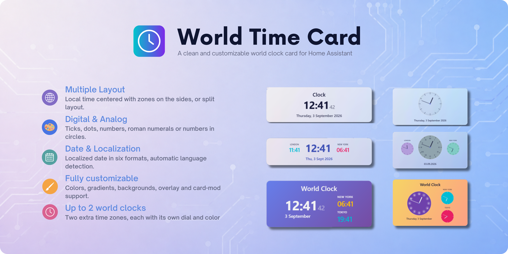

# World Time Card

[](https://www.home-assistant.io/integrations/marketplace)
[](https://github.com/korova-sq/world-time-card/releases)
[](https://github.com/korova-sq/world-time-card/stargazers)
[](https://github.com/korova-sq/world-time-card/releases)
[](https://github.com/korova-sq/world-time-card/releases/latest)
[](https://github.com/korova-sq/world-time-card/issues)
[](https://opensource.org/licenses/MIT)
[](https://buymeacoffee.com/korova.sq)



A clean and customizable world clock card for [Home Assistant](https://www.home-assistant.io/).
Show the local time as a **digital** or **analog** clock, add up to **two extra time
zones**, and style every part of it — all from the UI editor.

---

## 🤔 What is World Time Card?

A decorative yet practical clock for your dashboard. Pick a digital or analog face,
choose how the dial looks (ticks, dots, numbers, roman numerals or numbers-in-circles),
add a localized date in the format you like, and drop in a couple of world clocks with
their own labels, dial styles and colors. Backgrounds, gradients, transparency and
`card-mod` variables let you match it to any dashboard.

---

## ✨ Features

- 🕐 **Digital & analog** clock faces
- 🔲 **Digital styles** — plain digits, **boxes** (hours & minutes in coloured boxes, colon included) or a **LED** look with 7-segment digits, weekday column and optional seconds
- 🌤️ **Optional weather block** — condition icon and temperature next to the digital clock, from any `weather` entity
- 🔀 **Two layouts** — clocks in a row with the local time centered, or a split layout with the zones stacked to the side
- 🎯 **Dial styles** — ticks, dots, numbers, roman numerals or numbers-in-circles, with quarter / hour / full detail
- 🌍 **Up to 2 world clocks**, each with its own label, dial style and colors
- 📅 **Localized date** in six formats, with automatic language detection
- 📐 **Four sizes** (small → extra large) that scale everything proportionally
- 🎨 **Separate colors for dial and digits/markers** — for the local clock and for each zone; auto-contrast keeps things readable on dark dials
- 🖼️ **Backgrounds** — transparent, image + overlay, or any CSS color / gradient, with an optional light-text mode and an optional transparent margin (`background_inset`) for neumorphic themes
- 👆 **Native interactions** — tap, hold and double-tap actions (more-info, navigate, URL, perform action, toggle)
- 📏 **Auto-fit** — the clock scales down by itself when it would be wider than the card
- 🛠️ **card-mod friendly** — CSS classes and variables for every element (put the digits in coloured boxes, etc.)
- 🎚️ **Fine position** sliders to nudge hours, minutes, colon and seconds/AM-PM
- ⚙️ Fully configurable from the **visual editor**

---

## 📦 Installation

### Marketplace / HACS (recommended)

World Time Card is available in the default store.

[](https://my.home-assistant.io/redirect/hacs_repository/?owner=korova-sq&repository=world-time-card&category=plugin)

**Home Assistant 2026.11 or newer** — HACS is now built into Home Assistant as the **Marketplace**:

1. Open **Settings → Marketplace** and search for **World Time Card**.
2. Open it and click **Download**.
3. Reload your browser (hard refresh).

**Older versions (2026.10 or earlier)** — use **HACS**:

1. Open **HACS** and search for **World Time Card**.
2. Open it and click **Download**.
3. Reload your browser (hard refresh).

### Manual

1. Download `world-time-card.js` from the [latest release](https://github.com/korova-sq/world-time-card/releases).
2. Copy it to `config/www/`.
3. Add the resource in **Settings → Dashboards → Resources**:
   ```yaml
   url: /local/world-time-card.js
   type: module
   ```

---

## ⚙️ Configuration

All options can be set from the visual editor. Minimal example:

```yaml
type: custom:world-time-card
```

| Option | Type | Default | Description |
|---|---|---|---|
| `type` | string | — | `custom:world-time-card` (required) |
| `title` | string | — | Optional title shown above the clock |
| `clock_style` | string | `digital` | `digital` or `analog` |
| `size` | string | `medium` | `small`, `medium`, `large`, `xlarge` |
| `bold` | boolean | `true` | Bold text for time, date, title and zone names |
| `language` | string | `system` | `system`, `it`, `en` (affects date & names) |
| `layout` | string | `row` | `row` (local centered) or `split` (local left, zones right) |
| `time_format` | string | `24` | `24` or `12` (AM/PM) |
| `dial_color` | color | — | **Dial color**: analog dial fill; digital `card` style: box color |
| `time_color` | color | — | **Time color**: digital digits, seconds, AM-PM; analog ticks/dots/numbers |
| **Digital style** | | | |
| `digital_style` | string | `plain` | `plain` (plain digits), `card` (hours & minutes in coloured boxes) or `led` (7-segment display with weekdays) — local clock only |
| **Analog dial** | | | |
| `dial_detail` | string | `minutes` | `quarters`, `hours` or `minutes` |
| `dial_markers` | string | `ticks` | `ticks`, `dots`, `disc`, `numbers`, `roman`, `none` |
| **Date** | | | |
| `show_date` | boolean | `true` | Show the date |
| `date_format` | string | `full` | `full`, `no_year`, `short`, `short_year`, `numeric`, `day_month` |
| `date_separator` | string | `/` | Separator for the `numeric` format: `/`, `-`, `.` |
| `date_position` | string | `below` | `below` or `above` the clock |
| `date_color` | color | — | Date text color |
| **Seconds** | | | |
| `show_seconds` | boolean | `false` | Show seconds on the local clock (in `led` style: small 7-segment seconds next to the minutes) |
| `show_seconds_tz` | boolean | `false` | Show seconds on the world clocks |
| **Element position** *(fine-tuning, in em; 0 = default)* | | | |
| `h_offset` | number | `0` | Nudge hours up/down |
| `m_offset` | number | `0` | Nudge minutes up/down |
| `colon_offset` | number | `0` | Nudge the `:` up/down |
| `tail_offset` | number | `0` | Nudge seconds/AM-PM up/down |
| **World clocks** | | | |
| `show_timezones` | boolean | `false` | Show the extra time zones |
| `timezones` | list | `[]` | Up to 2 zones (see below) |
| `tz_dial_detail` | string | `inherit` | Dial detail for zones (or `inherit` from local) |
| `tz_dial_markers` | string | `inherit` | Dial style for zones (or `inherit` from local) |
| **Weather** | | | |
| `weather_entity` | entity | — | A `weather` entity. Shows condition icon + temperature next to the digital clock. Only with `clock_style: digital` and no secondary time zones |
| **Background** | | | |
| `transparent` | boolean | `false` | Remove background, border and shadow |
| `background_image` | string | — | URL or `/local/…` image |
| `background_overlay` | number | `0` | Veil over the image: `-1` (lighter) … `0` … `+1` (darker) |
| `background_inset` | number | `0` | Transparent margin (0–40 px) between the card edge and the custom background (`background_image` / `background_css`). Lets neumorphic / inset themes show their groove. Corner radius follows the card's own radius minus the margin |
| `background_css` | string | — | Any CSS `background` value (color or gradient) |
| `light_text` | boolean | `false` | Force light text/markers (useful on dark backgrounds) |
| **Interaction** | | | |
| `tap_action` | action | `none` | Action on tap |
| `hold_action` | action | `none` | Action on hold (500 ms) |
| `double_tap_action` | action | `none` | Action on double tap |

### Time zones

Each entry in `timezones` accepts:

| Key | Type | Description |
|---|---|---|
| `tz` | string | IANA name, e.g. `Europe/London`, `America/New_York`, `Asia/Tokyo` |
| `label` | string | Optional display name (falls back to the city) |
| `color` | color | Optional dial color for that zone |
| `time_color` | color | Optional digits/markers color for that zone |

> **Note:** the card shows the local clock **plus up to 2 time zones**. In both layouts
> that means 3 clocks on screen at most.

### LED style

`digital_style: led` draws the time with 7-segment digits. The unlit segments are
faintly visible, a weekday column sits on the left (the current day is highlighted),
and AM/PM (12-hour format) goes at the bottom right. With `show_seconds: true`, small
seconds appear at the top right of the minutes.

The LED colour follows **Time color**, or the theme text color when it is not set.
On dark backgrounds it switches to a light color automatically.

### Weather block

Set `weather_entity` to show the current condition (outline icon) and temperature next
to the digital clock. It adapts to the chosen style: a single box in `card` style, a
7-segment temperature in `led` style. The block is hidden when `clock_style` is
`analog` or when secondary time zones are shown, to keep the card readable.

```yaml
type: custom:world-time-card
clock_style: digital
digital_style: led
weather_entity: weather.home
```

### Interaction

`tap_action`, `hold_action` and `double_tap_action` use the standard Home Assistant
action format and can be set from the **Interaction** section of the editor:

```yaml
type: custom:world-time-card
tap_action:
  action: navigate
  navigation_path: /lovelace/clocks
hold_action:
  action: more-info
  entity: weather.home
double_tap_action:
  action: url
  url_path: https://www.timeanddate.com
```

Supported actions: `none`, `more-info` (with `entity`), `navigate`, `url`,
`perform-action` and `toggle`. The pointer cursor appears only when an action is set.

### Auto-fit

If the content (for example `xlarge` with weather on a phone) is wider than the card,
the card reduces its scale until it fits. No configuration is needed.

---

## 📋 Examples

**Basic digital**
```yaml
type: custom:world-time-card
clock_style: digital
title: Clock
show_seconds: true
```

**Basic analog**
```yaml
type: custom:world-time-card
clock_style: analog
```

**Row · digital · colors**
```yaml
type: custom:world-time-card
clock_style: digital
title: World Clock
time_color: indigo
date_format: short_year
date_color: indigo
show_timezones: true
timezones:
  - tz: Europe/London
    label: London
    time_color: cyan
  - tz: America/New_York
    label: New York
    time_color: pink
```

**Local · digital · boxed digits**
```yaml
type: custom:world-time-card
clock_style: digital
title: World Clock
digital_style: card
dial_color: indigo
time_color: white
show_seconds: true
time_format: "12"
```

**Row · analog · roman + ticks**
```yaml
type: custom:world-time-card
clock_style: analog
title: World Clock
dial_detail: hours
dial_markers: roman
dial_color: "#90a4ae"
date_format: numeric
date_separator: "."
show_timezones: true
tz_dial_markers: ticks
tz_dial_detail: hours
timezones:
  - tz: Europe/London
    label: London
    color: "#b39ddb"
  - tz: America/New_York
    label: New York
    color: "#80cbc4"
```

**Split · digital · gradient**
```yaml
type: custom:world-time-card
clock_style: digital
title: World Clock
layout: split
size: large
date_format: day_month
show_seconds: true
background_css: "linear-gradient(135deg, #667eea, #764ba2)"
light_text: true
show_timezones: true
timezones:
  - tz: America/New_York
    label: New York
    color: amber
  - tz: Asia/Tokyo
    label: Tokyo
    color: cyan
```

**Split · analog · gradient**
```yaml
type: custom:world-time-card
clock_style: analog
title: World Clock
layout: split
date_format: no_year
dial_markers: disc
dial_detail: hours
dial_color: deep-purple
background_css: "linear-gradient(120deg, #f6d365, #fda085)"
show_timezones: true
tz_dial_markers: ticks
tz_dial_detail: hours
timezones:
  - tz: America/New_York
    label: New York
    color: cyan
  - tz: Asia/Tokyo
    label: Tokyo
    color: pink
```

---

## 🎨 Customization with card-mod

The card exposes CSS variables so you can restyle every element with
[card-mod](https://github.com/thomasloven/lovelace-card-mod) or a theme.
All variables fall back to the current theme values, so nothing changes until you set them.

> The *Transparent background* and *Background image* options force the card background
> with `!important`. To set the background from card-mod instead, leave both of those off.

| Variable | What it styles |
|---|---|
| `--wc-inset` | Margin set by `background_inset` (set automatically) |
| `--wc-bg-radius` | Corner radius of the background layer when `background_inset` > 0 (computed automatically) |
| `--wc-title-color` | Title |
| `--wc-time-color` | Digital time digits |
| `--wc-date-color` | Date |
| `--wc-label-color` | Zone names |
| `--wc-face-color` | Analog dial fill |
| `--wc-face-border-color` | Analog dial border |
| `--wc-tick-color` | Ticks / dots (overridden by `time_color` when set) |
| `--wc-num-color` | Numbers (arabic / roman / circled, overridden by `time_color`) |
| `--wc-hand-color` | Hour & minute hands |
| `--wc-second-color` | Second hand |
| `--wc-pin-color` | Center pin |
| `--wc-box-color` | Digit box background (`digital_style: card`, same as `dial_color`) |
| `--wc-digit-color` | Digits inside the box (`digital_style: card`, same as `time_color`) |
| `--wc-date-gap` | Space between time and date (default `8px`) |
| `--wc-wx-color` | Weather icon and temperature (follows `--wc-time-color` by default) |
| `--wc-led-color` | LED digits color (`digital_style: led`) |
| `--wc-led-day-color` | Weekday column in LED style |
| `--wc-led-off-opacity` | Visibility of unlit segments (default `0.02`) |
| `--wc-led-glow` | Optional glow, e.g. `drop-shadow(0 0 0.08em #3ddc84)` (off by default) |

### Element classes (digital)

The digital time is split into separate elements, so you can style each part —
handy together with `digital_style: card` (see below) or on your own with card-mod:

| Class | Element |
|---|---|
| `.wc-time` | The whole digital time |
| `.wc-h` | Hours (e.g. `07`) |
| `.wc-m` | Minutes (e.g. `22`) |
| `.wc-colon` | The `:` separator |
| `.wc-sec` | Seconds (small) |
| `.wc-ampm` | AM/PM (small) |
| `.wc-date` | The date line |

> **Boxed digits, no CSS needed:** set **Digital style → Boxes** in the editor (local
> clock only) to put hours and minutes in coloured boxes, colored with **Dial color**
> (the colon follows it too, for visibility); digits, seconds and AM/PM follow
> **Time color**. If the digits don't look centered inside the box, use the
> **Element position** sliders (hours, minutes, colon, seconds/AM-PM) to nudge them —
> the perfect value can differ slightly per font/device.

**Gradient fill with light text**
```yaml
type: custom:world-time-card
card_mod:
  style: |
    ha-card {
      background: linear-gradient(135deg, #667eea, #764ba2) !important;
      border-radius: 20px;
    }
    :host {
      --wc-title-color: #ffffff;
      --wc-time-color: #ffffff;
      --wc-date-color: rgba(255,255,255,0.85);
      --wc-hand-color: #ffffff;
    }
```

**LED, neon green on dark**
```yaml
type: custom:world-time-card
clock_style: digital
digital_style: led
show_date: true
weather_entity: weather.home
card_mod:
  style: |
    ha-card {
      background: #0b1210;
      --wc-led-color: #3ddc84;
      --wc-led-day-color: #7fe3a8;
      --wc-wx-color: #3ddc84;
      --wc-date-color: #a7c4b5;
      --wc-led-glow: drop-shadow(0 0 0.08em #3ddc84);
    }
```

**Colored border**
```yaml
type: custom:world-time-card
card_mod:
  style: |
    ha-card {
      border: 3px solid var(--primary-color);
      border-radius: 22px;
    }
```

**Rounded pill boxes** *(custom shape on top of `digital_style: card`)*
```yaml
type: custom:world-time-card
digital_style: card
card_mod:
  style: |
    .wc-h, .wc-m { border-radius: 999px; }
```

**Rounded pill boxes**
```yaml
type: custom:world-time-card
card_mod:
  style: |
    .wc-h, .wc-m {
      background: #4caf50;
      color: white !important;
      padding: 0.08em 0.3em;
      border-radius: 999px;
    }
```

---

## ☕ Support

If you enjoy this card and want to say thanks, a coffee is always welcome!

[](https://buymeacoffee.com/korova.sq)

---

## 🤝 Contributing

Issues, ideas and pull requests are welcome. Translations are especially appreciated —
the editor currently ships with English and Italian.

---

## 📄 License

Released under the [MIT License](LICENSE).
